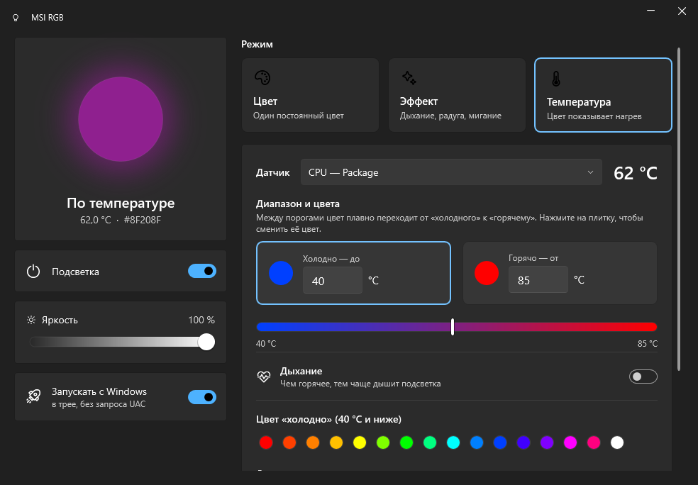
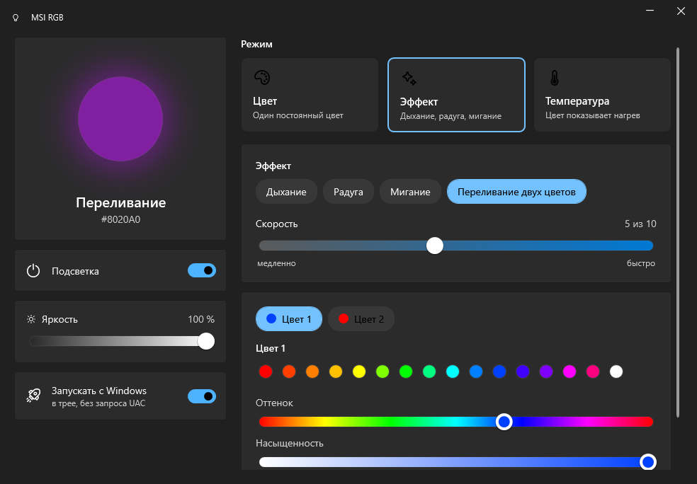
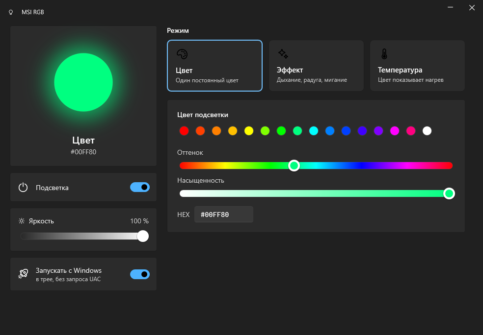
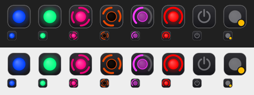

# MSI RGB

A small, free, open replacement for **MSI Mystic Light** on MSI motherboards whose RGB is driven by
MSI's Renesas microcontroller. One tray app, no MSI Center, no services.

| Temperature | Effect | Colour |
|---|---|---|
|  |  |  |

* **Colour**: any static colour (swatches, hue/saturation sliders, #HEX)
* **Effect**: breathing (rate in breaths per minute), rainbow, blink, two-colour crossfade, with speed control.
  Fast breathing inhales quicker than it exhales, like the real thing
* **Temperature**: like Mystic Light's "temperature" mode, but working. Pick any sensor
  (CPU package, cores, GPU, RAM, ...), a "cold" and a "hot" threshold and their colours; in between the
  colour fades smoothly. Optionally the light *breathes*, slowly when cold and faster as it heats up
  (both rates adjustable). Sensors come from [LibreHardwareMonitor](https://github.com/LibreHardwareMonitor/LibreHardwareMonitor).
* global brightness, on/off, start with Windows (logon task, no UAC prompt)
* the tray icon mirrors the LEDs live: colour, breathing, a spinning ring for effects, a gauge for temperature

  

## Supported boards

| Board | SMBus subsystem | Status |
|---|---|---|
| MSI Z370I GAMING PRO CARBON AC (MS-7B43) | 1462:7B43 | verified |

Other MSI boards that Mystic Light lists with chipset `Renesas2…6` very likely use the same protocol,
but the app refuses to write to unverified boards. Open an issue with your board's `MS-xxxx` and its
SMBus subsystem id to add it.

Boards whose RGB sits on the Nuvoton Super I/O (OpenRGB "MSI-RGB") or on the USB Mystic Light
controller (Z390 and newer) are **not** this protocol: use [OpenRGB](https://openrgb.org) for those.

## Install

1. Install [PawnIO](https://pawnio.eu) (the signed low-level I/O driver; FanControl and
   LibreHardwareMonitor install it too) and the .NET 10 Desktop Runtime.
2. **Uninstall MSI Center / Mystic Light.** It resets the MCU at start-up and fights any other writer.
3. Copy the release folder anywhere (e.g. `C:\Program Files\MsiRgb`) and run `MsiRgb.exe`
   (administrator: PawnIO requires it). Enable *Start with Windows* in the app.

Settings live in `%APPDATA%\MsiRgb\settings.json`.

## How it works

Reverse-engineered from MSI's `MBAPI_x86.dll` (`RenesasLEDControlV3`). Byte-data writes to SMBus
7-bit address **0x29** (MSI writes it as `0x52`, 8-bit notation):

| Reg | Meaning |
|---|---|
| 0x80–0x83 | zone bitmask (JRGB1 = 0x80 bit 0, board zones = 0x80 bits 1–7 and 0x81 bit 0) |
| 0x9F | mode; `2` = static (MSI first clears 0x88–0x8A) |
| 0x88 / 0x89 / 0x8A | R / G / B; writing 0x8A latches the colour |
| 0x90 / 0x91 / 0x95 / 0x99 | MCU effects (parameters in 0xE0–0xE5); only blink was reliable on MS-7B43 |
| 0x87 | brightness; no visible effect on MS-7B43 |

Because only static colour is reliable in hardware, effects and brightness are computed in software
(≈25 fps, single latch write per frame). The MCU is write-only (reads return 0xFF) and keeps the last
colour when the app exits.

## ⚠️ Safety

On this board **7-bit 0x50 and 0x52 are the DDR4 SPD EEPROMs and SPD write protection is off**.
A tool that took MSI's "0x52" literally as a 7-bit address would overwrite a DIMM's SPD. The address
here is a hard-coded constant and writes are gated on the exact board ID.

All SMBus traffic goes through PawnIO's signed `SmbusI801` module and the shared
`Global\Access_SMBUS.HTP.Method` mutex, so it coexists with FanControl / LibreHardwareMonitor.

## Build

```
dotnet test
dotnet publish src/MsiRgb.App -c Release -o out      # builds on Windows or Linux
out\MsiRgb.exe --screenshot docs                     # re-render the screenshots (no hardware access)
```

License: MIT; the embedded PawnIO module is LGPL-2.1.
